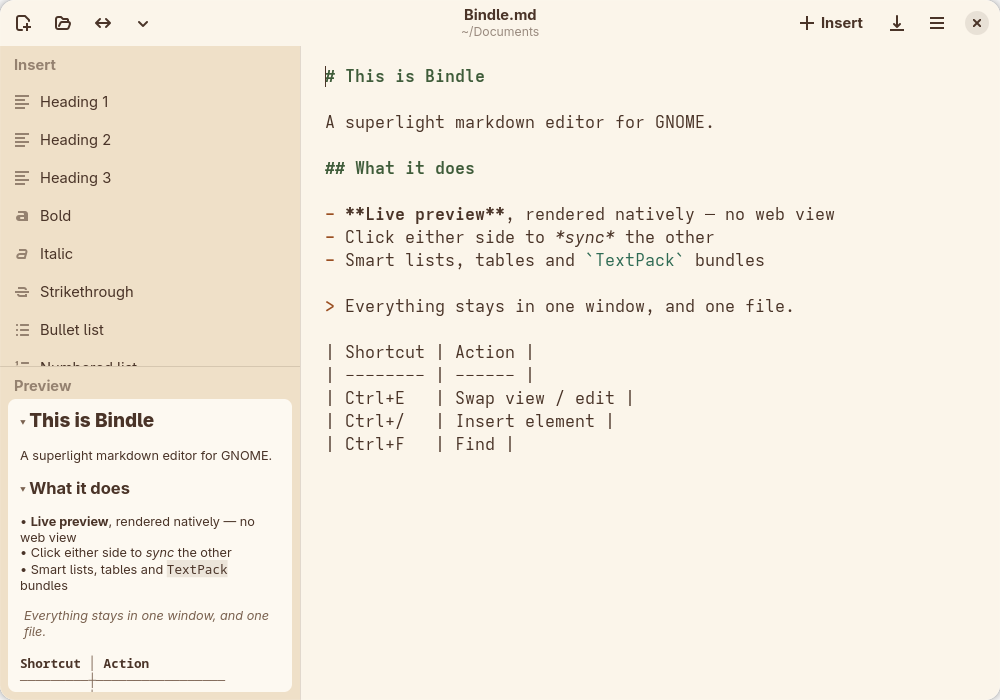

# Bindle

A tiny Markdown editor for GNOME, written in Rust with GTK4 + Libadwaita. Created with the use of AI. The Flatpak download is under 1 MB.


## Features

- **Flexible layout** — sidebar + editor with draggable dividers, an optional horizontal layout (editor on top, insert + preview below), and a view mode (<kbd>Ctrl</kbd>+<kbd>E</kbd> or the ↔ button) that swaps the preview into the main pane for comfortable reading. Each of the three sidebar panels (Files, Insert, Preview) can be shown or hidden on its own. Optionally open existing files straight into view mode. Everything — window size, dividers, layout, last file, and per document its folded sections and view mode — is remembered between launches.
- **Files panel** — your recent files as a quiet list in the sidebar that doesn't reshuffle while you click through it. Pin a file to keep it at the top for good; right-click → Open Location shows it in GNOME Files, or removes it from the list.
- **Live preview that stays put** — rendered natively (no web view), updated as you type with only the changed region redrawn, so it never flickers or jumps. The preview can follow your cursor (toggleable) and stays centered on the line you're editing. Click the ▾ beside a heading to fold its section (or fold everything into an outline from the header bar), tick task-list checkboxes right in the preview, and use *Fit preview to width* to shrink text and images for an overview of the full-width layout.
- **Click to sync, both ways** — click a word in the preview and the editor cursor jumps to it (double-click selects it); the preview tracks where you type. <kbd>Ctrl</kbd>+click opens links with your system's default app. With line numbers on, double-click a number (or beside a preview line) to pick that line in both panes; <kbd>Shift</kbd>+click extends the pick.
- **Find** — <kbd>Ctrl</kbd>+<kbd>F</kbd> searches the editor, or the preview in view mode, highlighting every match with a running count; <kbd>Enter</kbd>/<kbd>Shift</kbd>+<kbd>Enter</kbd> step through them.
- **TextBundle / TextPack support** — open and save `.textbundle` folders and `.textpack` files (the [textbundle.org](https://textbundle.org) standard used by Bear, Ulysses, iA Writer…). Export any document as a self-contained TextPack that carries its images and attached files with it — and when you Save As a document that references local files, Bindle offers to keep them together as a pack.
- **Attachments** — Insert → Attach file embeds a PDF (or anything else) into your document's assets; Link file references it in place. Attachments in packs open read-only with the system app, and right-click on a link saves a copy out.
- **Insert sidebar & popover** — one click (or <kbd>Ctrl</kbd>+<kbd>Space</kbd> for the searchable popover) inserts headings, lists, tables, links, code blocks and more at the cursor; wrapping snippets (bold, links, …) wrap the current selection.
- **More than Markdown** — also opens plain text (older non-UTF-8 files are read as Windows-1252, so æøå survive, and saved back as UTF-8), NFO/DIZ art (decoded as CP437 and left unwrapped, so the box drawing lines up), JSON, YAML, TOML/INI, shell scripts and XML, each with keyword highlighting, and registers for them so they appear under "Open With" in GNOME Files. These open as a full-width editor: no preview panel rendering syntax you are already looking at, and the Insert list steps aside too. Highlighting re-tags only the lines that actually changed, so it stays out of the way in large files.
- **OpenDocument Text** — open `.odt` files from LibreOffice and friends as Markdown: headings, emphasis, links, lists, tables, quotes, code, footnotes and embedded pictures come across; page layout, fonts, comments and tracked changes don't. Because of that, the original is never overwritten — saving an imported document creates a new Markdown file or TextPack. **Export → As ODT…** goes the other way for any document, with images embedded.
- **Printing & export** — <kbd>Ctrl</kbd>+<kbd>P</kbd> opens your system's print dialog and prints the *rendered* document: real headings, lists, quotes, tables that keep their columns, and embedded images, laid out for the paper you pick (A4, Letter, landscape — Bindle re-renders for it rather than letting the printer scale it). The same renderer backs **Export → As PDF…**, next to self-contained HTML, ODT and TextPack.
- **Smart lists & tables** — Enter continues bullet/task/numbered lists (numbers increment) and adds new table rows; Enter or Backspace on an empty item ends the list.
- **Images** — the picker inserts document-relative paths, pasting an image from the clipboard saves it into the document's `assets/` folder, and right-click → Copy Image in the preview copies the original back out. Web images render after you press **Load** on the per-document banner (configurable: Ask / Always / Never), and thumbnails are cached so typing stays snappy.
- **Appearance & behavior** — Bindle's own warm sage/cream/cocoa palette or your stock GNOME theme, light/dark/system style, separate editor and preview font sizes, line numbers (in the editor and, optionally, source line numbers in the preview) and word wrap, all remembered between launches, single- or multi-instance, open last file or start blank, and a "New Document" template for GNOME Files (installable from `bindle.sh`).
- **The basics done right** — undo/redo (<kbd>Ctrl</kbd>+<kbd>Z</kbd>), <kbd>Ctrl</kbd>+<kbd>B</kbd>/<kbd>Ctrl</kbd>+<kbd>I</kbd> for bold/italic, unsaved-changes protection everywhere (even when opening files from GNOME Files), toast notifications, atomic saves that never leave a half-written file, follow symlinks and keep a private file private, and a warning banner (with Reload) when the file changes on disk behind your back. Files on network shares (gvfs: SMB, WebDAV, …) reopen even after a reboot — Bindle remounts the share itself — and a hung share never freezes the window. **About → What's New** lists the changes in each release.



## Installing (Flatpak — easiest)

Grab the latest `.flatpak` bundle from [GitHub Releases](https://github.com/oyzmo/bindle/releases/latest) or [oyzmo.no/apps](https://oyzmo.no/apps) and install it:

```sh
flatpak install bindle-1.27.0.flatpak
```

or just double-click it in GNOME Software. Works on any Linux desktop with Flatpak set up; the GNOME runtime is fetched automatically if you don't have it.

You can also build the Flatpak yourself from the included manifest:

```sh
flatpak-builder --user --install --force-clean build-dir no.oyzmo.Bindle.yml
```

## Building from source

First download the source zip (`bindle-<version>-src.zip`) from [GitHub Releases](https://github.com/oyzmo/bindle/releases/latest) or [oyzmo.no/apps](https://oyzmo.no/apps) and unpack it:

```sh
unzip bindle-1.27.0-src.zip
cd bindle-1.27.0
```

Then run the helper menu:

```sh
./bindle.sh
```

It can install the build dependencies (dnf/apt/pacman/zypper), compile a release build, install the app into your GNOME desktop (`~/.local`, with icon and desktop entry), and uninstall it again.

Manual build: `cargo build --release` (needs GTK4 ≥ 4.14 and Libadwaita ≥ 1.5 development headers).

## Keyboard shortcuts

| Shortcut | Action |
| --- | --- |
| Ctrl+N / Ctrl+O | New / Open |
| Ctrl+E | Swap view/edit mode |
| Ctrl+S / Ctrl+Shift+S | Save / Save As |
| Ctrl+P | Print |
| Ctrl+F | Find (Enter / Shift+Enter: next / previous) |
| Ctrl+Space (or Ctrl+/, Ctrl++) | Insert element at cursor |
| Ctrl+B / Ctrl+I | Bold / Italic |
| Ctrl+Z / Ctrl+Shift+Z | Undo / Redo |

## Licence

Bindle is free software under the **GNU General Public License, version 3 or later** — see [LICENSE](LICENSE). Use it, change it, ship it; just pass the same freedoms on, and keep the source available with it.

It is built with open source Rust crates and runs against the GNOME runtime, all under their own licences. Those are reproduced in full in [THIRD-PARTY.md](THIRD-PARTY.md), which ships with the app alongside the licence — in `/app/share/licenses/no.oyzmo.Bindle/` for the Flatpak, and in `~/.local/share/licenses/no.oyzmo.Bindle/` when installed with `bindle.sh`.

A source archive (sources + both licence files) is attached to each release, and `./source.sh` builds the same `bindle-<version>-src.zip` from a checkout.
